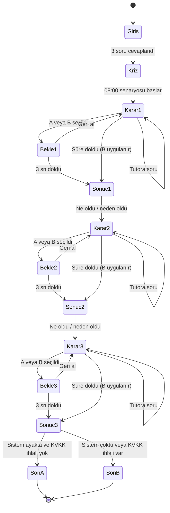

# SE Primer: spec.md

> Sürüm 0.2 · Tarih: 26 Ekim 2026 · Durum: Onaylandı (geri al bandı ve serbest tutor sorusu eklendi)
> YZM301 Yazılım Gerçekleme ve Test · Ödev 1 · Adım 1 / 6

## 1. Amaç

SE Primer, yazılım mühendisliği kararlarını oynanabilir bir senaryoda deneyimletir. Oyuncu bir sağlık sisteminde nöbetçi mühendis olarak mimari, test ve KVKK kararları verir; uygulama her kararın teknik sonucunu gösterir. Arkasında çalışan Sokratik AI Tutor cevap vermez, soru sorarak düşündürür.

## 2. Problem Tanımı

### 2.1 Senaryo

Sabah 08:00. Bir hastanenin randevu sistemi çöktü. Dün gece yeni sürüm canlıya çıkmış ve 300 hasta randevu bekliyor. Oyuncu nöbetçi mühendistir; 08:25'e kadar sistemi ayağa kaldırmak ve bu süreçte veriyi korumak zorundadır.

### 2.2 Çözülmesi gereken sorun

Kriz anında ekipler hızlı karar vermek zorundadır, ama her hızlı karar bir mimari, test ve gizlilik bedeli taşır. Öğrenciler bu bedelleri ders kitabında okur, gerçek bir kriz anında deneyimlemez. SE Primer bu boşluğu kapatır: kararların sonuçlarını, nedenleriyle birlikte, güvenli bir ortamda gösterir.

### 2.3 Hedef kullanıcı

YZM301 öğrencileri ve yazılım mühendisliğine ilgi duyan başlangıç seviyesindeki kişiler. Uygulama telefonda açılacak biçimde tasarlanır.

## 3. Kapsam

### 3.1 Kapsam içi

- Telefonda açılan web uygulaması (Google AI Studio üzerinden yayınlanan link).
- Girişte 3 soru: seviye, rol, hedef. Anlatı bu cevaplara göre uyarlanır.
- Tek sağlık senaryosu: 08:00 randevu sistemi çöküşü.
- 3 karar noktası: Mimari, Test, KVKK.
- 2 farklı son: İyi ve Kötü.
- Her karar sonrası "ne oldu, neden oldu" geri bildirimi.
- Sokratik AI Tutor: ipucu verir, cevabı vermez.
- Türkçe arayüz. Kayıt tutmayan, oturum bazlı çalışma.

### 3.2 Kapsam dışı

- Kullanıcı kaydı, oturum açma, şifre ve profil yönetimi.
- İkinci bölüm veya devam eden hikâye.
- Gerçek hasta verisi. Tüm veriler kurgusaldır.
- Native mobil uygulama (iOS/Android). Uygulama yalnızca tarayıcıda çalışır.
- Oyun ilerlemesinin kalıcı kaydı ve liderlik tablosu. Her oturum baştan başlar.

## 4. Oyun Kuralları ve Akış

### 4.1 Giriş: 3 soru

| Soru | Seçenekler | Etkisi |
|---|---|---|
| Seviye | Yeni başladım / Deneyimliyim | Yeni başladım: her karar ekranında otomatik ipucu. Deneyimliyim: karar başına 60 saniyelik süre sınırı, ipucu yok. |
| Rol | Geliştirici / Test mühendisi / Proje yöneticisi | Kriz ekranındaki görev tanımını değiştirir (ör. test mühendisine test raporu vurgulanır). |
| Hedef | Mimari / Test / KVKK | Tutor'un ilk ipucunun odağını belirler. |

### 4.2 Senaryo: 3 karar

| # | Karar | Seçenek A | Seçenek B |
|---|---|---|---|
| 1 | Mimari | Eski sürüme geri dön | Canlıda yama yap |
| 2 | Test | Önce kısa test koş | Hemen yayına al |
| 3 | KVKK | Logdaki hasta adını maskele | Logu ekibe olduğu gibi at |

Karar 2 yalnızca Karar 1'de yama (B) seçildiğinde sistem durumunu etkiler. Karar 1'de geri dönüş (A) seçildiyse eski sürüm zaten çalışan bir sürümdür; Karar 2'nin sonucu sistem durumunu değiştirmez. Ekran bunu neden cümlesiyle açıklar.

### 4.3 Sonuç kuralları

- **Sistem ayakta:** Karar 1 = A **veya** (Karar 1 = B **ve** Karar 2 = A)
- **KVKK ihlali:** Karar 3 = B
- **Süre aşımı:** Deneyimliyim modunda karar verilmezse o karar için B uygulanır.

| Sistem ayakta | KVKK ihlali | Son |
|---|---|---|
| Evet | Hayır | **Son A · İYİ**: 08:25, sistem ayakta, veri güvende |
| Evet | Evet | **Son B · KÖTÜ**: sistem ayakta ama KVKK ihlali |
| Hayır | Hayır | **Son B · KÖTÜ**: sistem çöktü |
| Hayır | Evet | **Son B · KÖTÜ**: sistem çöktü ve KVKK ihlali |

Son B tek ekran olarak tasarlanır. Metni, hangi kuralın ihlal edildiğine göre değişir.

### 4.4 Karar sonrası geri bildirim

Her karardan sonra sonuç ekranında şu dört bilgi gösterilir:

1. Seçilen seçenek
2. Sistem durumu (ayakta / çöktü)
3. Veri durumu (güvende / ihlal)
4. Neden: 1-2 cümlelik teknik gerekçe

Sonuç ekranı, oyuncu karar vermeden doğru seçeneği göstermez.

**Geri al (3 saniye):** Seçim yapıldıktan sonra 3 saniye boyunca "Geri al" seçeneği görünür. Geri alınırsa seçim iptal edilir ve aynı karar yeniden sorulur. 3 saniye dolunca seçim kesinleşir ve sonuç gösterilir. Bu kural üç kararın tamamında geçerlidir.

### 4.5 AI Tutor kuralları

- **Serbest soru:** Oyuncu her iki seviyede de tutora yazabilir. Deneyimliyim'de süre bu sırada da çalışmaya devam eder.
- **Sokratik yöntem:** Tutor soru sorarak yönlendirir. Bir yanıtta en fazla bir ipucu ve bir soru bulunur.
- **Cevap yasağı:** Tutor hiçbir karar için "A daha iyi", "B doğru" gibi yargı vermez.
- **Israr durumu:** Oyuncu "cevabı söyle" derse tutor yine cevap vermez, ipucunu bir adım somutlaştırır.
- **Konu dışı:** Senaryo dışı sorularda oyuncuyu nazikçe krize geri çağırır.
- **Uzunluk:** En fazla 3 cümle.
- **Örnek soru:** "Geri dönmeden önce veritabanı şemasının değişip değişmediğini nasıl anlarsın?"

## 5. Kabul Kriterleri

Her kriter Cypress testine dönüştürülebilecek biçimde yazılmıştır (Verilen / Ne zaman / O zaman).

**AK-1 · Yeni başlayan oyuncuya her kararda ipucu**
- Verilen: Oyuncu seviyesini "Yeni başladım" seçti.
- Ne zaman: Üç karar ekranından herhangi birine gelir.
- O zaman: O kararla ilgili bir ipucu, oyuncu istemeden ekranda görünür.

**AK-2 · Deneyimli oyuncuya süre baskısı**
- Verilen: Oyuncu seviyesini "Deneyimliyim" seçti.
- Ne zaman: Bir karar ekranı açılır.
- O zaman: 60 saniyelik sayaç görünür. Süre dolduğunda B uygulanır ve "Süre doldu" mesajı gösterilir. Oyuncu tutora yazarken sayaç durmaz.

**AK-3 · Tutor cevabı vermez**
- Verilen: Oyuncu tutora "Hangisi doğru?" diye sorar.
- Ne zaman: Tutor yanıt verir.
- O zaman: Yanıtta A veya B'nin doğru olduğu söylenmez; yanıt en fazla 3 cümledir ve bir soru içerir.

**AK-4 · Her seçim geri bildirim üretir ve 3 saniye içinde geri alınabilir**
- Verilen: Oyuncu bir karar için A veya B seçti.
- Ne zaman: Seçimden sonra 3 saniye dolmadan "Geri al" dokunulur; ya da 3 saniye dolar.
- O zaman: Geri alınırsa seçim iptal olur ve karar yeniden sorulur. Dolarsa sonuç ekranı açılır; seçilen seçenek, sistem durumu, veri durumu ve bir neden cümlesi görünür.

**AK-5 · KVKK ihlali her zaman Son B'dir**
- Verilen: Oyuncu Karar 3'te B seçeneğini (logu olduğu gibi at) seçti.
- Ne zaman: Oyun sona erer.
- O zaman: Sistem ayakta olsa da çökmüş olsa da Son B gösterilir ve metin KVKK ihlalini açıkça belirtir.

## 6. Durum Makinesi

## 7. Varsayımlar ve Açık Sorular

- **V1 (görünmez varsayım):** Oyuncu, yeni sürümün veritabanı şemasını değiştirdiğini başlangıçta bilmez. Tutor bunu sorularla fark ettirir.
- **V2:** Karar 2'nin sistem durumuna etkisi yalnızca Karar 1 yama olduğunda vardır (bkz. 4.2).
- **V3:** Süre sınırı yalnızca "Deneyimliyim" seviyesinde uygulanır.
- **V4:** Logdaki hasta adları kurgusaldır; uygulama gerçek kişisel veri içermez.
- **V6 (geri al, onaylandı):** Her seçimden sonra 3 saniye "Geri al" seçeneği var. Bu, yanlış dokunuşu önler ve kabul kriteri AK-4'e eklendi.
- **V7 (serbest tutor sorusu, onaylandı):** Tutora her iki seviyede de yazılabilir. Deneyimliyim'de sayaç durmaz.
- **V5 (seviye sayısı):** Ödevdeki iki örnek seviye (Yeni başladım, Deneyimliyim) esas alındı. Ara seviye eklenmedi; ekstra yol Cypress kapsamını ve eval kapsamını büyütür, puana katkısı yoktur.
- **Açık soru:** Rol seçiminin anlatıya etkisinin derinliği Stitch tasarım aşamasında netleşecek.

## 8. Model Kapısı (v2): takılma tahmini

Bu bölüm model gereksinimini, eval metriğini ve kabul eşiğini içerir. Eşik eğitimden **önce** yazıldı. Eşiği geçmeyen model yayınlanmaz.

### 8.1 Amaç

Oyuncu bu karar ekranında takılacak mı? Model, oyuncunun davranışından bu olasılığı tahmin eder. Olasılık eşiği geçerse oyunun davranışı değişir: tutor daha somut bir ipucu verir ve Deneyimliyim modunda 60 saniyelik sayaç kalkar ("Yardım modu").

### 8.2 Girdi (özellikler)

Her özellik karar ekranı açıldığında bilinen bilgilerden hesaplanır. Etiketle sızıntı olmaması için "Geri al" ve tutora yazılan soru özellik olarak kullanılmaz.

| Özellik | Tanım | Birim |
|---|---|---|
| `seviye_yeni` | Oyuncu "Yeni başladım" seçtiyse 1, "Deneyimliyim" seçtiyse 0 | 0/1 |
| `karar_no` | Karar sırası | 1, 2, 3 |
| `ilk_tiklama_sn` | Karar ekranı açıldıktan sonra ilk seçime kadar geçen süre | saniye |
| `onceki_yanlis_sayisi` | Önceki kararlarda sistemi çökerten ya da KVKK ihlali yaratan seçim sayısı | adet |
| `onceki_takildi` | Önceki karar için etiket (takıldı mı) | 0/1 (ilk karar için 0) |
| `ipucu_sayisi_once` | Bu karardan önce "İpucu iste" düğmesine basılma sayısı | adet |

### 8.3 Etiket (hedef)

`takildi = 1`, o kararda oyuncu "Geri al" kullandıysa **veya** tutora soru yazdıysa. Aksi halde `0`.

### 8.4 Veri

- En az **15 gerçek oturum** (her oturum 3 karar, yani en az 45 satır). Gerçek kişilerden alınır, kayıt anonimdir (ad, e-posta, cihaz kimliği yok).
- Veri Toplama Modu: uygulama oturum sonunda satırları CSV olarak indirir. `kaynak` sütunu `gercek` ya da `sentetik` olarak işaretlenir.
- Eğitim için en az 10 pozitif ve 10 negatif satır gerekir. Yoksa `train.py` durur.

### 8.5 Eval metriği ve kabul eşiği (eğitimden önce sabit)

- **Metrik:** 5 katlı tabakalı çapraz doğrulamada ortalama ROC-AUC.
- **Kabul eşiği:** ortalama ROC-AUC ≥ **0,70**. Ayrıca dengeli doğruluk (balanced accuracy) çoğunluk sınıfı tahmininden (0,50) yüksek olmalı.
- **Eşdeğerlik:** `model.onnx` ile sklearn arasındaki en büyük olasılık farkı ≤ **1e-4**.
- **Tarayıcı paritesi:** Python referans olasılığı ile tarayıcıdaki `onnxruntime-web` olasılığı arasındaki fark ≤ **1e-4** (5 referans girdide).
- **Eşik olasılığı:** `takildi` tahmini ≥ **0,50** ise "Yardım modu" açılır.

### 8.6 Model kabul örnekleri

**AK-6 · Model eşiği geçmezse yayınlanmaz**
- Verilen: Eğitim betiği çalıştırılır ve ortalama ROC-AUC 0,70'in altında kalır.
- Ne zaman: `train.py` tamamlanır.
- O zaman: Betik hata verir, `model/` klasörüne dosya yazılmaz ve yayın adımı çalışmaz.

**AK-7 · Model kararı oyunu değiştirir**
- Verilen: Oyuncunun `takildi` tahmini ≥ 0,50 olur.
- Ne zaman: Bir sonraki karar ekranı açılır.
- O zaman: Tutor, o kararla ilgili somut bir ipucu verir ve Deneyimliyim modunda sayaç görünmez. Tahmin 0,50'nin altındaysa bu değişiklikler olmaz.

**AK-8 · Tarayıcıdaki model Python ile aynı sonucu verir**
- Verilen: 5 referans girdi (`tests/parite.json`) tarayıcıda ve Python'da çalıştırılır.
- Ne zaman: Parite testi çalışır.
- O zaman: Her girdi için olasılık farkı ≤ 1e-4 olur.
